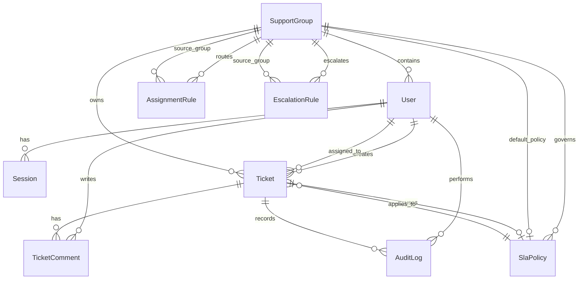

# Domain Model
The schema lives in `prisma/schema.prisma`, and the business rules for each entity live in the service files listed below. The model is intentionally support-group scoped rather than multi-tenant, so the authorization boundary is explicit but simpler than a full tenant model.

## Entities
- `User`
  - Schema/model file: `prisma/schema.prisma`
  - Primary service owner: `src/services/authService.ts` for login/session issuance, and `src/services/ticketService.ts` for actor-aware ticket operations.
  - Notes: the `role` and `supportGroupId` fields drive permission and visibility decisions.
- `Session`
  - Schema/model file: `prisma/schema.prisma`
  - Primary service owner: `src/services/authService.ts`
  - Notes: sessions are opaque tokens stored as hashes in `src/repositories/sessionRepository.ts`.
- `SupportGroup`
  - Schema/model file: `prisma/schema.prisma`
  - Primary service owner: `src/services/ticketService.ts` and `src/services/ruleService.ts`
  - Notes: this is the scope boundary for tickets, SLAs, and rules.
- `Ticket`
  - Schema/model file: `prisma/schema.prisma`
  - Primary service owner: `src/services/ticketService.ts`
  - Notes: lifecycle transitions, assignment, due dates, and comments all center on this model.
- `TicketComment`
  - Schema/model file: `prisma/schema.prisma`
  - Primary service owner: `src/services/ticketService.ts`
  - Notes: the `isInternal` flag is important because it separates support-only notes from customer-visible replies.
- `SlaPolicy`
  - Schema/model file: `prisma/schema.prisma`
  - Primary service owner: `src/services/ruleService.ts`
  - Notes: `src/services/ticketService.ts` consumes the policy to stamp due dates when a ticket is created.
- `AssignmentRule`
  - Schema/model file: `prisma/schema.prisma`
  - Primary service owner: `src/services/ruleService.ts`
  - Notes: `src/repositories/assignmentRuleRepository.ts` ranks rules, but the service owns the business meaning.
- `EscalationRule`
  - Schema/model file: `prisma/schema.prisma`
  - Primary service owner: `src/services/ruleService.ts` for creation and `src/services/escalationService.ts` for execution.
  - Notes: escalation is a background workflow, not a UI action.
- `AuditLog`
  - Schema/model file: `prisma/schema.prisma`
  - Primary service owner: `src/services/ticketService.ts`, `src/services/ruleService.ts`, and `src/services/escalationService.ts`
  - Notes: audit rows are written after the primary mutation so the log reflects successful business actions.

